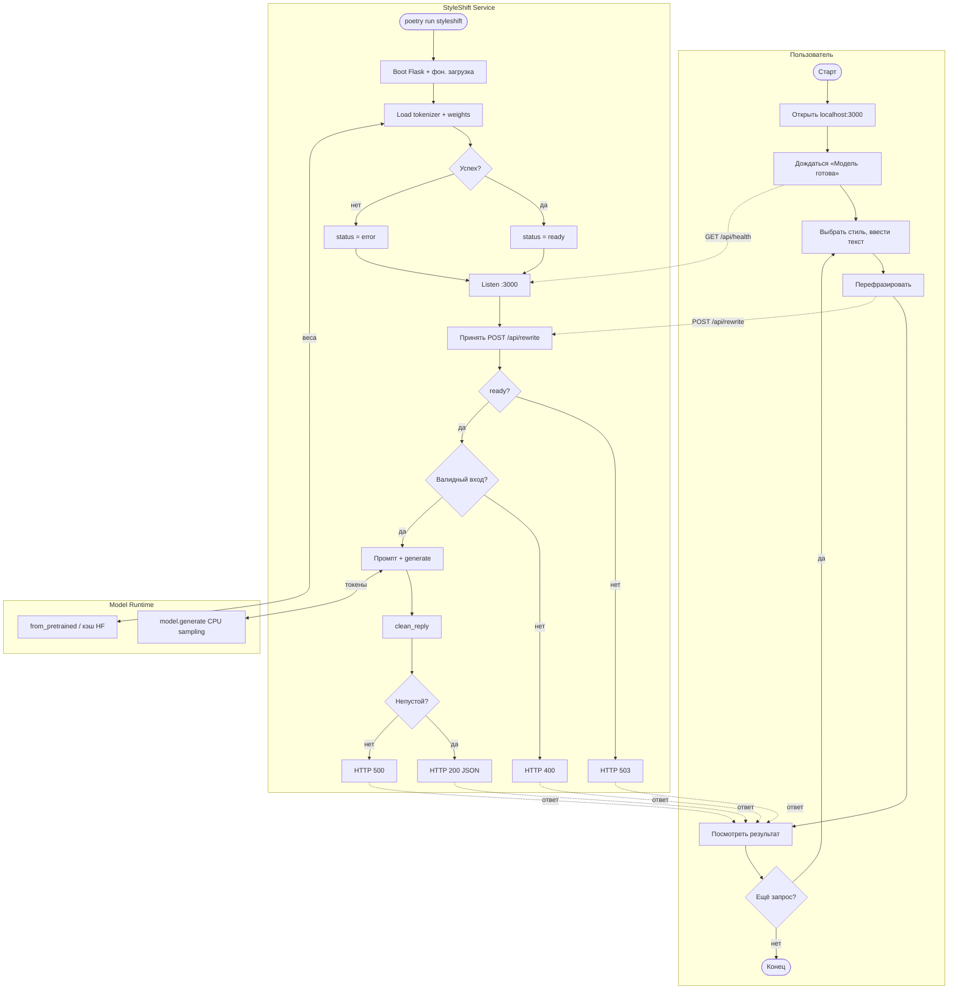

# BPMN: эксплуатация модели в StyleShift

Бизнес-процесс **эксплуатации** (operation) модели `Qwen2.5-1.5B-Instruct`
в проекте StyleShift: от запуска сервиса до выдачи перефразированного текста.

## Как открыть диаграмму

1. Файл BPMN 2.0: [`bpmn/styleshift-model-operation.bpmn`](bpmn/styleshift-model-operation.bpmn)
2. Откройте на [https://demo.bpmn.io](https://demo.bpmn.io) → *Open file*
   или в [Camunda Modeler](https://camunda.com/download/modeler/) / draw.io (импорт BPMN).

## Участники (pools)

| Pool | Роль |
|------|------|
| **Пользователь (браузер)** | Вводит текст, выбирает стиль, получает результат |
| **StyleShift Service** | Flask API: загрузка модели, валидация, оркестрация инференса |
| **Model Runtime (Qwen2.5)** | Загрузка весов (HF cache) и авторегрессионная генерация на CPU |

## Схема процесса (обзор)

## Ключевые развилки

1. **Загрузка модели** — успех → `ready`, иначе `error` (сервис всё равно слушает порт; rewrite даст 503).
2. **Готовность к инференсу** — не `ready` → **503**.
3. **Валидация** — пустой текст / неизвестный стиль / &gt;2000 символов → **400**.
4. **Пустой ответ после очистки** → **500**, иначе **200** с `rewritten`.

## Связь с кодом

| Шаг BPMN | Код |
|----------|-----|
| Boot + фоновая загрузка | `styleshift.__main__.main`, `ModelService.start_background_load` |
| Load weights | `ModelService.load` |
| Health / styles / rewrite | `styleshift.app.create_app` |
| generate + clean | `ModelService.rewrite`, `clean_reply` |
